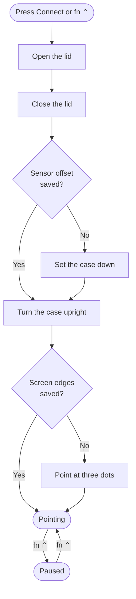
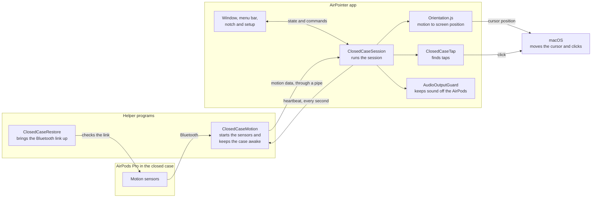

<p align="center">
  
</p>

<h1 align="center">AirPointer</h1>

<p align="center">
  <strong>Turn your AirPods case into a pointer for your Mac.</strong><br>
  Move the closed case to move the cursor. Tap its front to click.
</p>

<p align="center">
  
</p>

## Before you use it

| Effect | What happens |
|---|---|
| **Case data (Pro 2/3)** | Ending a session uses up the diagnostic data stored on the case. |
| **AirPods settings (Pro 2/3)** | Some AirPods connection settings stay as the session set them. We do not know yet if this change, or the case data change, lasts after the Bluetooth link resets. |
| **Audio** | Audio is moved off the AirPods during a session. Pro 2/3 connections also drop their Bluetooth link for a moment. Do not connect during a call. |
| **Microphone** | During a session, the app keeps Mac sound and the microphone off all AirPods. It restores them when the session ends. After a force quit, it restores them when you next open the app, if the AirPods are still connected. |
| **Silent audio (Pro 2/3)** | During a session, the app plays silence to the AirPods to keep their audio link active. You do not hear it. |
| **Cursor size** | A cursor smaller than 2× grows to 2× while you point. It returns to its size when you pause or disconnect. After a force quit, it returns when you next open the app. This uses a private macOS call. |

## Requirements

| Item | Status |
|---|---|
| AirPods Pro 3, macOS 26, Apple Silicon | Tested on one Mac with one pair |
| macOS 27 | Builds with no warnings and passes the offline checks; not tested with AirPods |
| AirPods 4 with ANC | Tested on one Mac with one pair |
| AirPods Pro 2 (Lightning and USB-C) | Recognized, not tested |
| AirPods 4 | Recognized, not tested |
| AirPods Pro 1 | Experimental, Tested on one Mac with one pair |
| AirPods paired with your Mac | Required |
| Xcode | Required to build |

Normal connect and disconnect have run many times on that Mac and pair. These
cases have not been tested on purpose:

- Force quit during a session
- Sleep and wake during a session
- Bluetooth lost during a session
- Calls and audio during and after a session

## Build and run

```sh
zsh ./build.sh
open AirPointer.app
```

The build also runs `--self-test` and the tap check. The other offline checks are
under [For developers](#for-developers). Do not build during a pointer session.

If AirPointer does not appear in the Accessibility list after a rebuild, run:

```sh
tccutil reset Accessibility local.airpointer
```

## Set it up

The first time you open the app, setup has four steps.

<p align="center">
  
</p>

1. **Allow:** Drag AirPointer into the Accessibility list. This lets it move the
   cursor and click.
2. **Connect:** Open the lid, close the lid, set the case down for a moment, and
   turn it upright.
3. **Calibrate:** Point at three dots to show the app where your screen is.
4. **Tap:** Tap the front of the case three times.

## Use it

Press **fn ⌃** in any app to connect. Press it again to pause or resume. To use a
different shortcut, go to Settings.

| To | Do this |
|---|---|
| Click | Tap the front of the case. |
| Double-click | Tap the front twice. |
| Right-click | Tap the back of the case. |
| Drag | Tap the front three times to pick up, move the case, then tap once to drop. |
| Scroll | Turn the case like a key. Turn further to scroll faster. Turn back to stop. |

Drag lock, back tap and twist to scroll each have a switch in Settings. While drag
lock is on, a double-click waits about 0.4 seconds for a third tap, so it does not
open a file or zoom a window before you can drag it.

### Present slides

When Keynote or PowerPoint is playing a slideshow in front, taps change slides
instead of clicking:

| Tap | Slide |
|---|---|
| Once | Next. It changes after 0.4 s, in case a second tap follows. |
| Twice quickly | Previous |

The cursor keeps moving over the slides, so you can still point at them. There is
nothing to turn on. In any other window, a tap clicks.

<p align="center">
  
</p>

On the tested AirPods, a session ends about 30 minutes after the lid closes. To
continue, open and close the lid. See [Known limitations](#known-limitations).

<details>
<summary><strong>The connect steps as a chart</strong></summary>



</details>

## Known limitations

**Sessions end about 30 minutes after the lid closes.** The app does not set this
limit. At that point motion stops, and the AirPods stay unreachable until you open
the lid. To continue, open and close the lid. In one test, reconnecting with the lid
closed did not reset the limit.

The likely cause is timer `0x63` in the earbud firmware. We found it by reading
`rkof.bin` (H2, version 9A348), the firmware image for the tested AirPods Pro 3:

| Address | What it does |
|---|---|
| `0x17d2a4` | Builds a status mask. It starts the timer if the mask is nonzero, the state check passes and the timer is not already running. It cancels the timer if the mask is zero. |
| `0x17d326` | Loads the timer's length: 1,800,000 ms, or 30 minutes. |
| `0x17d294` | The state check: the firmware's dock state equals 6. This probably means docked with the lid closed. |
| `0x17cddc` | Runs when the timer ends. It checks the state again, then calls a fatal assert that does not return. |

Measured sessions ended at the same time, about 1,805 seconds after the lid closed.
This comes from reading the firmware and from those timings. No live capture has
confirmed it yet.

## Troubleshooting

| Problem | What to do |
|---|---|
| The app does not connect | Turn off Bluetooth on your iPhone. Your iPhone can hold the AirPods. |
| "Connecting" does not end | Open the lid and keep it open until the app tells you to close it. |
| The pointer lags or motion stops | Make sure no other app, such as OBS or a browser call, uses the AirPods as a microphone. |
| The pointer stutters just after you connect | This is normal for about 20 seconds. |
| "Set it down" takes a long time | Use a firm, flat surface and do not touch the case. |
| Taps do not click | Go to Settings > Teach Tap. Do this again if you change how you hold the case. |
| A back tap clicks, or a front tap right-clicks | Go to Settings > Teach Tap. The back is the opposite of the direction it learns. |
| Pages scroll when you only meant to point | Turn off twist to scroll in Settings, and include the `scroll` lines from the session log when you report it. |
| Double-clicks feel slow | Turn off drag lock in Settings. |

## How it works



1. **Connect:** `ClosedCaseRestore` makes sure the AirPods' ordinary Bluetooth link
   is up. `ClosedCaseMotion` then reconnects them once, because the motion channel
   only answers just after a connection.
2. **Stream:** `ClosedCaseMotion` starts the sensors and sends paced requests to
   keep the closed case awake. It sends the motion data to the app.
3. **Keep alive:** The app sends a heartbeat every second. If the app stops, the
   helper stops the sensors and releases what it holds.
4. **Point:** `Orientation.js` calculates the case's orientation and converts it to
   a screen position.
5. **Click:** `ClosedCaseTap` looks for a sudden movement in the direction of a tap.
   If it finds one, the app clicks and plays a short sound on the Mac. A second
   detector looks for the opposite push, a tap on the back, and right-clicks. The case
   rocks back after every tap, so a push from the other side within 0.35 seconds is
   ignored. `DragLock` turns three quick taps into a held button.
6. **Scroll:** `TwistScroll` measures the turn about the pointing direction from a
   resting twist that follows your grip. A scroll starts only when the case turns at
   least 8° within 0.3 seconds, much more than the aim moves, and reaches 20° from
   that rest. It stops within 12°. Sweeping the pointer rolls the wrist too, but the
   aim moves more than the twist, so it does not scroll.

If motion stops for less than two seconds, the pointer stops and then continues.
If motion stops for longer, the pointer pauses and continues when motion returns.

## Project layout

```text
Sources/
  AirPointer/          The app
    App/               Startup, the link to the windows, and the shortcut
    Session/           The session, motion math, taps, drag lock, scrolling, audio
                       guard, cursor size
    Interface/         The window, menu bar, notch, setup and Tap Test
    Checks/            Window and pose checks; other checks sit beside their code
  ClosedCaseMotion/    The helper, with native H2 and system H1 motion inputs
  ClosedCaseRestore/   The helper that brings the Bluetooth link up
Tests/                 Recorded taps and handling for the tap check
Assets/                Images, sounds and the 3D case model
Scripts/               Make the case and README images
Docs/                  The design system
build.sh               Builds AirPointer.app and runs the checks
```

`Sources/ClosedCaseMotion/CaseSustainedRenewal.m` lists the helper's exit codes at
the top. [Docs/DESIGN-SYSTEM.md](Docs/DESIGN-SYSTEM.md) has the rules for the
interface. [Assets/README.md](Assets/README.md) explains the images and sounds.

## For developers

<details>
<summary><strong>Data on your Mac</strong></summary>

The app keeps its data in `~/Library/Application Support/AirPointer/`. It does not
send any of this anywhere.

| File | Contents |
|---|---|
| `closed-case-target.txt` | The AirPods to use |
| `closed-case-grip.json` | Saved screen edges |
| `closed-case-sensor-calibration.json` | Saved sensor offset, kept for one week |
| `PointerSessions/` | Logs from the newest ten sessions |
| `TapTests.jsonl` | Tap Test scores |

During a session, the app's preferences also save which audio devices it moved.
The saved names include the AirPods' Bluetooth address.

In a session's `native.log`:

- `STEP` lines show the time of each connection step.
- `HOLD` lines show the motion count so far and its delay, about once a second.
- `tap` lines explain each tap.
- `drag` lines show each pick-up and drop.
- `scroll` lines show why each scroll started, and why a twist did not scroll.
- The `EXIT` line shows why the session ended.

</details>

<details>
<summary><strong>Tap Test</strong></summary>

Taps are tuned on one person so far, so your score may differ.

Connect, then go to **File > Developer > Tap Test**. The test takes about 75
seconds and tells you when to tap.

To also save a session's raw motion, run this before you connect. The recording has
no size limit. Expect roughly 20 MB for a 30-minute session.

```sh
defaults write local.airpointer recordMotion -bool true
```

</details>

<details>
<summary><strong>Offline checks</strong></summary>

These checks do not use Bluetooth. `--check-home` opens real windows, so run it on
a logged-in Mac.

```sh
AirPointer.app/Contents/MacOS/AirPointer --self-test
AirPointer.app/Contents/MacOS/AirPointer --check-home
AirPointer.app/Contents/MacOS/AirPointer --check-pointer-settings
AirPointer.app/Contents/MacOS/AirPointer --check-closed-case-native
AirPointer.app/Contents/MacOS/AirPointer --check-audio-output-policy
AirPointer.app/Contents/MacOS/AirPointer --check-closed-case-tap Tests/TapFixtures.csv
AirPointer.app/Contents/Resources/ClosedCaseMotion.bin --self-test
```

</details>

## Uninstall

Quit AirPointer, delete this folder, then run:

```sh
rm -rf ~/Library/Application\ Support/AirPointer
defaults delete local.airpointer
tccutil reset Accessibility local.airpointer
tccutil reset BluetoothAlways local.airpointer
```

## License

The code uses the [MIT License](LICENSE). The license does not cover `Assets/`.
Apple owns the AirPods model that the case images are made from, and the sounds
have their own license. See [Assets/LICENSE.md](Assets/LICENSE.md).
